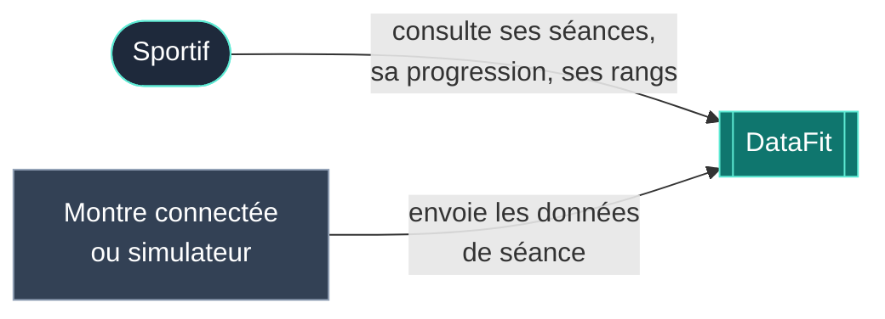
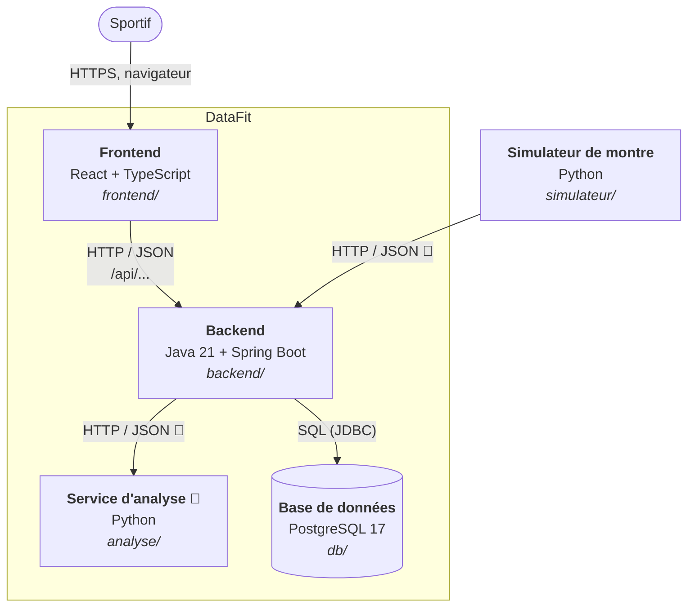
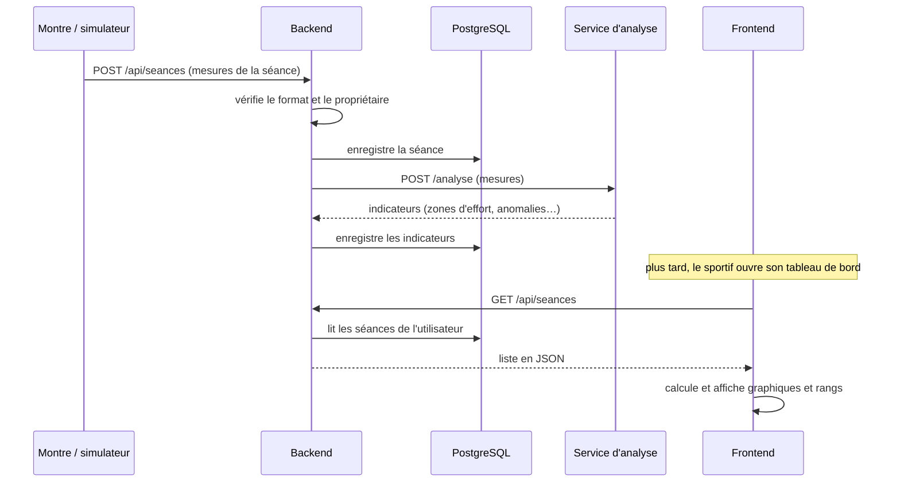

# Architecture

Ce document décrit comment DataFit est construit. Il suit une version allégée du modèle **C4** (voir [glossaire](glossaire.md#c4)), très utilisé en entreprise : on décrit le système à plusieurs niveaux de zoom, du plus large (« qui utilise le système ? ») au plus fin (« comment est organisé ce bout de code ? »).

## 1. Objectif du système

DataFit récupère les données de séance d'une montre connectée (fréquence cardiaque, vitesse, position), les stocke, les fait analyser (progression, efforts anormaux) et affiche le résultat au sportif sur un tableau de bord. Un système de **rangs E → Z** par exercice permet au sportif de se situer.

### Exigences qui pèsent sur l'architecture

- **Deux équipes, deux langages** : la partie informatique travaille en Java et TypeScript, la partie sciences des données en Python. Chacune doit pouvoir avancer sans bloquer l'autre.
- **Données sensibles** : fréquence cardiaque et position sont des données personnelles, potentiellement des données de santé (voir [Sécurité](securite.md)).
- **Lancement simple** : n'importe quel membre de l'équipe (ou le jury) doit pouvoir lancer tout le projet avec une seule commande.
- **Deux livrables** : un site web, et à terme une application de bureau.

## 2. Contexte (niveau 1 du C4)

Qui interagit avec DataFit, vu de l'extérieur :



Tant qu'on n'a pas de vraie montre branchée, c'est le **simulateur de montre** (en Python) qui joue son rôle en générant des données réalistes.

## 3. Conteneurs (niveau 2 du C4)

Un « conteneur » au sens C4 est un programme qui tourne de façon indépendante (à ne pas confondre avec un conteneur Docker, même si ici chacun tourne justement dans le sien).



| Conteneur | Rôle | Techno | Dossier | Équipe |
|---|---|---|---|---|
| Frontend | Ce que voit l'utilisateur : pages, graphiques, rangs | React 19, TypeScript, Vite | `frontend/` | Info |
| Backend | Point d'entrée unique des données : comptes, séances, sécurité. Seul à parler à la base | Java 21, Spring Boot 4 | `backend/` | Info |
| Base de données | Stockage durable | PostgreSQL 17 | `db/` | Info |
| Service d'analyse 🚧 | Calculs sur les séances : progression, détection d'efforts anormaux | Python | `analyse/` | SD |
| Simulateur | Génère des données de montre pour tester sans matériel | Python | `simulateur/` | Info / SD |

### Règles qui découlent de ce découpage

1. **Seul le backend parle à la base.** Le front et le service Python ne s'y connectent jamais directement. Ça garde un seul endroit où vérifier les droits d'accès, et la base peut changer de structure sans casser les autres.
2. **Le front ne parle qu'au backend.** Il n'appelle jamais le service Python lui-même : c'est le backend qui le fait et renvoie le résultat. Le front n'a donc qu'une seule adresse à connaître.
3. **Les échanges se font en JSON sur HTTP** (voir [API](api.md)). C'est ce qui permet à Java et Python de travailler ensemble sans partager de code : il suffit de se mettre d'accord sur le format des messages.

## 4. Flux principal : d'une séance au tableau de bord 🚧

Ce que le système fera une fois les briques reliées :



## 5. Composants (niveau 3 du C4)

### Frontend

```
frontend/src/
├── main.tsx          point d'entrée : monte l'application React dans la page
├── App.tsx           table des routes (quelle adresse affiche quelle page)
├── pages/            une page = un fichier (Dashboard, Seance, Profil…)
├── hooks/            la logique de chaque page (useDashboard, useSeance…)
├── components/       morceaux d'interface réutilisables (graphes, Sidebar, BadgeRang…)
├── lib/              fonctions pures : calcul des rangs, formats, regroupements
├── data/             données de référence (barèmes, sports) et données de démonstration
└── styles/           une feuille CSS par page ou composant, App.css pour les couleurs communes
```

Le découpage suit une règle simple, appelée **séparation des responsabilités** :

- une **page** ne fait qu'afficher ;
- son **hook** (voir [glossaire](glossaire.md#hook)) contient l'état et la logique de la page ;
- les **fonctions de `lib/`** sont *pures* : mêmes entrées, même résultat, sans dépendre de React. On peut donc les tester seules.

**Routage** : `App.tsx` déclare deux familles de pages. Les pages plein écran (`/`, `/connexion`, `/cgu`, `/donnees-personnelles`) et les pages de l'application, qui partagent la barre latérale via `AppLayout` (`/dashboard`, `/sport`, `/montre`, `/historique`, `/historique/:id`, `/progression`, `/sommeil`, `/profil`).

**Système de rangs** : les barèmes sont dans `data/paliers.ts` (seul fichier à modifier pour ajuster un palier) et le calcul dans `lib/rangs.ts`. Pour les exercices à charge, le seuil s'adapte au poids du sportif selon la loi `force ∝ poids^(2/3)`.

### Backend

```
backend/src/main/java/com/datafit/backend/
├── BackendApplication.java   point d'entrée Spring Boot
├── HelloController.java      endpoints de test (/api/hello, /api/heart-rate)
└── HeartRateResponse.java    format de réponse de /api/heart-rate
```

Organisation cible, standard dans les projets Spring (architecture **en couches**) :

```
com.datafit.backend/
├── controller/   reçoit les requêtes HTTP, vérifie l'entrée, renvoie la réponse
├── service/      la logique métier (règles du domaine)
├── repository/   l'accès à la base (interfaces Spring Data JPA)
├── model/        les entités, c'est-à-dire les classes qui correspondent aux tables
├── dto/          les objets échangés en JSON (jamais les entités directement)
└── config/       sécurité, CORS…
```

Chaque couche n'appelle que celle du dessous : `controller → service → repository`. Un contrôleur ne touche jamais la base directement.

### Service d'analyse (Python)

```
analyse/
├── app/main.py           point d'entrée de l'API Python (vide pour l'instant)
├── app/traitements/      fonctions de calcul de l'équipe SD
├── notebooks/            explorations Jupyter (pas utilisées par le site)
├── tests/
└── requirements.txt      bibliothèques Python nécessaires
```

Le service exposera quelques endpoints HTTP appelés par le backend. Le choix du framework Python est décrit dans l'[ADR 0006](adr/0006-service-analyse-python-separe.md). Règle importante : **les notebooks servent à explorer, le code dans `app/` sert à produire.** Une fonction validée dans un notebook est recopiée proprement dans `app/traitements/` avec un test.

## 6. Déploiement

Résumé (détails dans [Déploiement](deploiement.md)) :

- **En local, avec Docker Compose** : les quatre services (base, back, front, et à terme analyse) se lancent avec `docker compose up --build`. Le front est servi par nginx, qui transmet les appels `/api/...` au backend.
- **En ligne** : seul le front est déployé, sur Vercel. Le back n'est pas encore hébergé.

## 7. État d'avancement

| Brique | État |
|---|---|
| Front : 10 pages, navigation, graphiques, rangs | ✅ fait, **données de démonstration en dur** |
| Front : profil et performances | ✅ enregistrés dans le navigateur (`localStorage`), pas encore côté serveur |
| Docker Compose (base + back + front) | ✅ fait |
| Base : table `utilisateur` | ✅ créée |
| Back : squelette Spring Boot + 2 endpoints de test | ✅ fait |
| Back : inscription / connexion | 🚧 en cours |
| Back : séances | 🚧 prévu |
| Front branché sur le back | 🚧 prévu |
| Service d'analyse Python | 🚧 dossier prêt, code à venir |
| Simulateur relié au back | 🚧 simulateur écrit, pas encore dans le dépôt |
| Application de bureau | 🚧 prévu |

## 8. Risques et dette technique connus

La **dette technique** désigne les raccourcis pris volontairement ou non, qu'il faudra « rembourser » plus tard.

- **Données en dur dans le front** : `data/seances.ts` et les hooks lisent des données inventées. Chaque hook devra être branché sur l'API, un par un.
- **Pas de tests automatisés** pour l'instant, ni côté front ni côté back. Les fonctions de `lib/rangs.ts` sont les premières candidates.
- **Création des tables par un script unique** (`db/init.sql`), qui ne s'exécute qu'à la création de la base. Voir [Base de données](base-de-donnees.md#faire-évoluer-le-schéma) pour la solution recommandée.
- **Un ancien mot de passe** de base est visible dans l'historique Git (dépôt public). Voir [Sécurité](securite.md).
