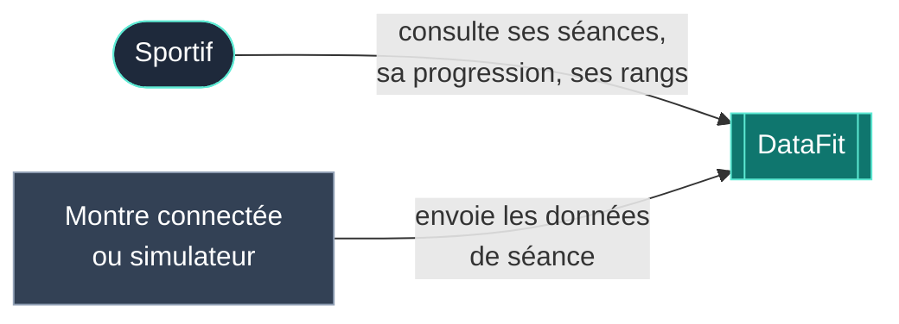
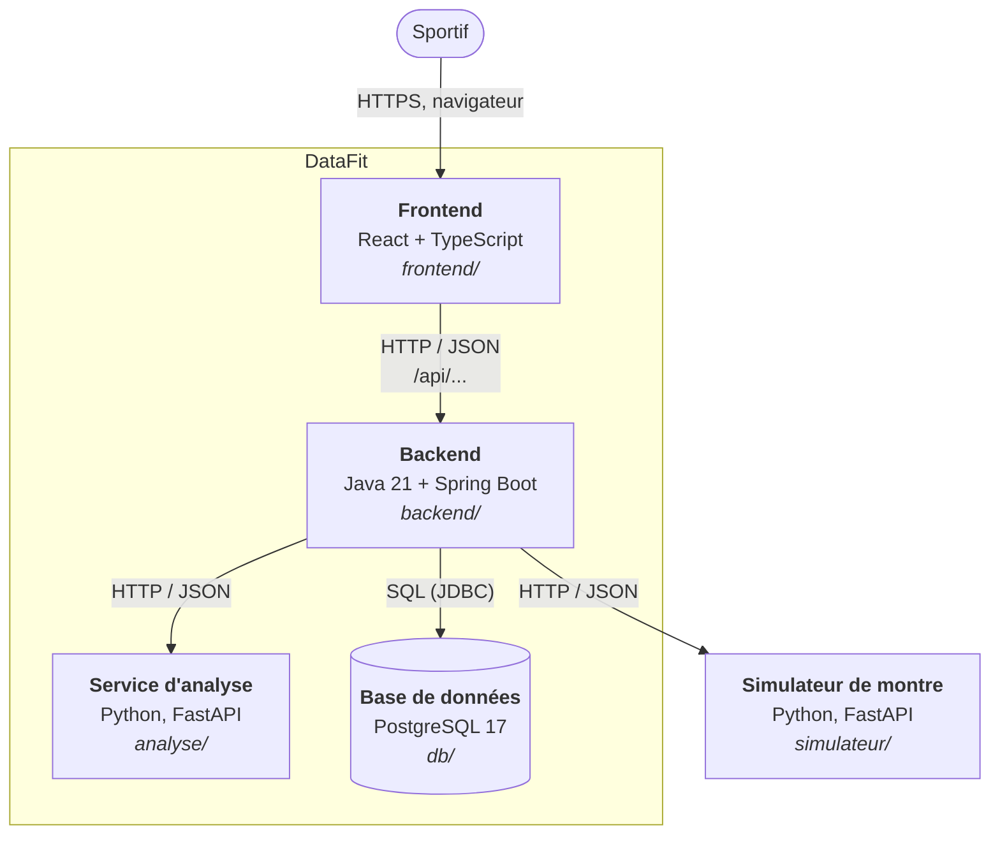
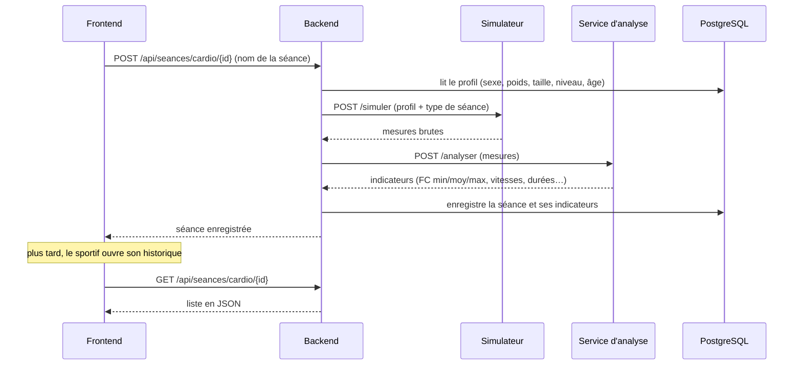

# Architecture

Ce document décrit comment DataFit est construit. Il suit une version allégée du modèle **C4** (voir [glossaire](glossaire.md#c4)), très utilisé en entreprise : on décrit le système à plusieurs niveaux de zoom, du plus large (« qui utilise le système ? ») au plus fin (« comment est organisé ce bout de code ? »).

## 1. Objectif du système

DataFit récupère les données de séance d'une montre connectée (fréquence cardiaque, vitesse, position), les stocke, les fait analyser (progression, efforts anormaux) et affiche le résultat au sportif sur un tableau de bord. Un système de **rangs E → Z** par exercice permet au sportif de se situer.

### Exigences qui pèsent sur l'architecture

- **Deux équipes, deux langages** : la partie informatique travaille en Java et TypeScript, la partie sciences des données en Python. Chacune doit pouvoir avancer sans bloquer l'autre.
- **Données sensibles** : fréquence cardiaque et position sont des données personnelles, potentiellement des données de santé (voir [Sécurité](securite.md)).
- **Lancement simple** : n'importe quel membre de l'équipe (ou le jury) doit pouvoir lancer tout le projet avec une seule commande.
- **Deux livrables** : un site web, et à terme une application de bureau.

## 2. Contexte (niveau 1 du C4)

Qui interagit avec DataFit, vu de l'extérieur :



Tant qu'on n'a pas de vraie montre branchée, c'est le **simulateur de montre** (en Python) qui joue son rôle en générant des données réalistes.

## 3. Conteneurs (niveau 2 du C4)

Un « conteneur » au sens C4 est un programme qui tourne de façon indépendante (à ne pas confondre avec un conteneur Docker, même si ici chacun tourne justement dans le sien).



| Conteneur | Rôle | Techno | Dossier | Équipe |
|---|---|---|---|---|
| Frontend | Ce que voit l'utilisateur : pages, graphiques, rangs | React 19, TypeScript, Vite | `frontend/` | Info |
| Backend | Point d'entrée unique des données : comptes, séances, sécurité. Seul à parler à la base | Java 21, Spring Boot 4 | `backend/` | Info |
| Base de données | Stockage durable | PostgreSQL 17 | `db/` | Info |
| Service d'analyse | Transforme les mesures en indicateurs : cardio, vélo, natation, musculation, sommeil, nutrition | Python, FastAPI | `analyse/` | SD |
| Simulateur | Génère des mesures de montre réalistes selon le profil, pour tester sans matériel | Python, FastAPI | `simulateur/` | Info / SD |

### Règles qui découlent de ce découpage

1. **Seul le backend parle à la base.** Le front et le service Python ne s'y connectent jamais directement. Ça garde un seul endroit où vérifier les droits d'accès, et la base peut changer de structure sans casser les autres.
2. **Le front ne parle qu'au backend.** Il n'appelle jamais le service Python lui-même : c'est le backend qui le fait et renvoie le résultat. Le front n'a donc qu'une seule adresse à connaître.
3. **Les échanges se font en JSON sur HTTP** (voir [API](api.md)). C'est ce qui permet à Java et Python de travailler ensemble sans partager de code : il suffit de se mettre d'accord sur le format des messages.

## 4. Flux principal : d'une séance au tableau de bord

Le sportif lance une séance depuis la page Montre. Tant qu'aucune vraie montre n'est branchée, le backend demande les mesures au simulateur :



Le même enchaînement sert au vélo, à la natation, à la musculation et au sommeil. Pour la nutrition, les repas sont saisis par l'utilisateur et seule l'analyse de la journée passe par le service Python.

Les mesures brutes ne sont pas conservées : seuls les indicateurs calculés sont enregistrés, ce qui limite le volume et les données personnelles stockées.

## 5. Composants (niveau 3 du C4)

### Frontend

```
frontend/src/
├── main.tsx          point d'entrée : monte l'application React dans la page
├── App.tsx           table des routes (quelle adresse affiche quelle page)
├── pages/            une page = un fichier (Dashboard, Seance, Profil…)
├── hooks/            la logique de chaque page (useDashboard, useSeance…)
├── components/       morceaux d'interface réutilisables (graphes, Sidebar, BadgeRang…)
├── lib/              fonctions pures : calcul des rangs, formats, regroupements
├── data/             données de référence (barèmes, sports) et données de démonstration
└── styles/           une feuille CSS par page ou composant, App.css pour les couleurs communes
```

Le découpage suit une règle simple, appelée **séparation des responsabilités** :

- une **page** ne fait qu'afficher ;
- son **hook** (voir [glossaire](glossaire.md#hook)) contient l'état et la logique de la page ;
- les **fonctions de `lib/`** sont *pures* : mêmes entrées, même résultat, sans dépendre de React. On peut donc les tester seules.

**Routage** : `App.tsx` déclare deux familles de pages. Les pages plein écran (`/`, `/connexion`, `/mot-de-passe-oublie`, `/creation-profil`, `/contact`, `/installer`, `/cgu`, `/donnees-personnelles`) et les pages de l'application, qui partagent la barre latérale via `AppLayout` (`/dashboard`, `/performance`, `/sport`, `/programmation`, `/montre`, `/historique`, `/progression`, `/sommeil`, `/nutrition`, `/chatbot`, `/premium`, `/profil`).

**Appels au back** : regroupés dans `services/`, un fichier par domaine (`montreService.ts`, `nutritionService.ts`, `sport/*.ts`).

**Système de rangs** : les barèmes sont dans `data/paliers.ts` (seul fichier à modifier pour ajuster un palier) et le calcul dans `lib/rangs.ts`. Pour les exercices à charge, le seuil s'adapte au poids du sportif selon la loi `force ∝ poids^(2/3)`.

### Backend

Le code est rangé **par fonctionnalité** : chaque dossier contient le contrôleur, le service, le dépôt (accès à la base), l'entité et les objets de requête de son domaine.

```
backend/src/main/java/com/datafit/backend/
├── BackendApplication.java   point d'entrée Spring Boot
├── config/          CORS, encodage des mots de passe (BCrypt), format des erreurs
├── inscription/     création de compte
├── connexion/       connexion
├── utilisateur/     entité et dépôt des comptes
├── profil/          profil du sportif
├── contact/         formulaire de contact
├── montre/
│   ├── client/      appels HTTP au simulateur et au service d'analyse
│   ├── cardio/  velo/  natation/  muscu/  sommeil/
├── nutrition/       repas et analyse nutritionnelle
└── sport/           performances déclarées : sbd, halterofilie, streetlifting,
                     calisthenics, natation, souplesse, athletisme
```

Dans chaque domaine, la règle reste celle des couches : `Controller → Service → Repository`. Un contrôleur ne touche jamais la base directement.

### Service d'analyse (Python)

```
analyse/
├── app/main.py           API FastAPI : un seul endpoint /analyser qui choisit l'analyseur selon le champ "sport"
├── app/traitements/      un fichier par analyse : cardio, vélo, natation, muscu, sommeil, nutrition
├── notebooks/            explorations Jupyter de l'équipe SD (pas utilisées par le site)
└── requirements.txt
```

### Simulateur (Python)

```
simulateur/
├── main.py               API FastAPI : endpoint /simuler, valide le profil et la séance demandés
└── cardio.py  velo.py  natation.py  muscu.py  sommeil.py   un générateur de mesures par type
```

Règle importante : **les notebooks servent à explorer, le code dans `app/` sert à produire.** Une fonction validée dans un notebook est recopiée proprement dans `app/traitements/`.

## 6. Déploiement

Résumé (détails dans [Déploiement](deploiement.md)) :
- **En local, avec Docker Compose** : les cinq services (base, simulateur, analyse, back, front) se lancent avec `./lancer.sh`. Le front est servi par nginx, qui transmet les appels `/api/...` au backend.
- **En ligne** : seul le front est déployé, sur Vercel. Le back et les services Python ne sont pas encore hébergés.

## 7. État d'avancement

| Brique | État |
|---|---|
| Front : pages, navigation, graphiques, rangs | ✅ fait |
| Front : tableau de bord, progression et page Montre branchés sur les vraies séances | 🚧 utilisent encore des données de démonstration (`data/seances.ts`, `data/sommeil-demo.ts`) |
| Profil : lecture et modification depuis le serveur | 🚧 seule la création existe côté back ; le front relit le profil dans le navigateur |
| Mot de passe oublié | 🚧 page prête, endpoints à écrire |
| Inscription et connexion | ✅ fait |
| Profil créé côté serveur | ✅ fait |
| Séances montre (cardio, vélo, natation, muscu) : simulateur → analyse → base | ✅ fait |
| Sommeil : simulation, analyse, historique | ✅ fait |
| Nutrition : repas et analyse de la journée | ✅ fait |
| Performances déclarées par discipline | ✅ fait |
| Docker Compose (5 services) | ✅ fait |
| CI GitHub Actions (build du front et du back) | ✅ fait |
| Authentification par session ou jeton | 🚧 prévu (voir [Sécurité](securite.md#authentification)) |
| Back et services Python hébergés en ligne | 🚧 prévu |
| Vraie montre connectée | 🚧 prévu |
| Application de bureau | 🚧 prévu |

## 8. Risques et dette technique connus

La **dette technique** désigne les raccourcis pris volontairement ou non, qu'il faudra « rembourser » plus tard.

- **Pas d'authentification sur les endpoints** : l'identifiant de l'utilisateur est passé dans l'adresse et n'est pas vérifié côté serveur. C'est le chantier prioritaire, voir [Sécurité](securite.md#authentification).
- **Données de démonstration** : plusieurs hooks (`useDashboard`, `useProgression`, `useMontre`, `useSeance`) lisent encore `data/seances.ts` au lieu de l'API.
- **Peu de tests automatisés** : la CI vérifie que le projet compile, mais les calculs (rangs côté front, analyses côté Python) ne sont presque pas testés.
- **Schéma géré par des scripts SQL numérotés** (`db/01_…sql` à `db/07_…sql`), rejoués par `lancer.sh`. Ça marche pour ajouter des tables, pas pour modifier une colonne existante. Voir [Base de données](base-de-donnees.md#faire-évoluer-le-schéma).
- **Un ancien mot de passe** de base de développement est visible dans l'historique Git (dépôt public). Voir [Sécurité](securite.md).
