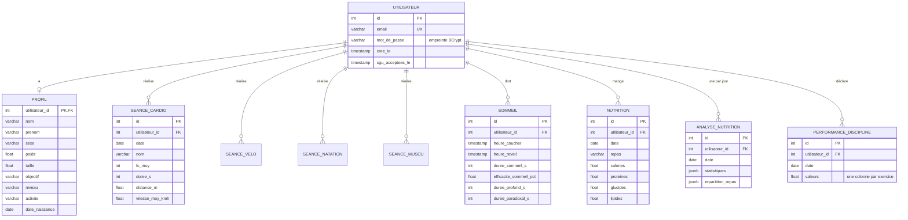

# Base de données

DataFit utilise **PostgreSQL 17** (choix expliqué dans l'[ADR 0003](adr/0003-postgresql.md)). Seul le backend s'y connecte.

## Schéma actuel

Les tables sont créées par les scripts numérotés de [`db/`](../db/), exécutés dans l'ordre par `lancer.sh` :

| Fichier | Tables |
|---|---|
| `01_utilisateur_profil.sql` | `utilisateur`, `profil` |
| `02_nutrition.sql` | `nutrition`, `analyse_nutrition` |
| `03_seance.sql` | `seance_cardio`, `seance_natation`, `seance_muscu`, `seance_velo` |
| `04_sports.sql` | `sbd`, `halterofilie`, `streetlifting`, `calisthenics`, `natation`, `souplesse`, `athletisme` |
| `05_seances.sql` | reprise des tables de séances pour les bases déjà créées |
| `06_contact.sql` | `message_contact` |
| `07_sommeil.sql` | `sommeil` |



Le schéma est simplifié : seules les colonnes principales sont montrées. `PERFORMANCE_DISCIPLINE` représente les sept tables de performances déclarées, qui ont toutes la même forme (une ligne par utilisateur et par jour, contrainte `UNIQUE (utilisateur_id, date)`). `SEANCE_CARDIO` représente aussi les tables vélo, natation et musculation, qui ajoutent leurs propres indicateurs.

Quelques choix expliqués :

- **Une table par type de séance** plutôt qu'une table générique : chaque sport a des indicateurs différents (longueurs en natation, séries en musculation, roue libre à vélo), stockés dans de vraies colonnes typées.
- **Seuls les indicateurs sont stockés**, pas les mesures seconde par seconde : le service d'analyse les calcule, puis les mesures brutes sont abandonnées.
- **`JSONB` pour une partie de l'analyse nutritionnelle** : les statistiques détaillées évoluent avec le travail de l'équipe SD ; les garder en JSON évite de modifier la table à chaque nouvel indicateur.
- **`ON DELETE CASCADE` partout** : supprimer un compte supprime toutes ses données, ce qui répond au droit à l'effacement du RGPD.
- **Contraintes `CHECK` sur le sommeil** : réveil après le coucher, durées positives, efficacité entre 0 et 100 %, FC cohérente. La base refuse une donnée incohérente même si le code a un bug.

## Conventions de nommage

- Tables et colonnes en `snake_case`, au singulier : `seance`, `utilisateur_id`.
- Clé primaire : `id`. Clé étrangère : `<table>_id`.
- Pas d'accents ni de mots réservés SQL (`user`, `order` sont à éviter).
- Toute colonne de date se termine par `_le` (`cree_le`) ou est un nom explicite (`debut`).

## Faire évoluer le schéma

### Le fonctionnement actuel

`lancer.sh` rejoue tous les fichiers de `db/` à chaque lancement. Comme ils utilisent `CREATE TABLE IF NOT EXISTS`, une nouvelle table apparaît sur toutes les machines sans rien effacer.

La limite : `CREATE TABLE IF NOT EXISTS` ne modifie jamais une table qui existe déjà. Pour ajouter ou changer une colonne, il faut écrire un `ALTER TABLE` à la main (comme dans `05_seances.sql`), ou repartir d'une base vide avec `./lancer.sh --reinitialiser`, ce qui efface toutes les données locales.

### La solution standard : les migrations (recommandé)

Une **migration** est un petit fichier SQL numéroté qui décrit *un changement* du schéma. Un outil retient lesquelles ont déjà été appliquées et n'exécute que les nouvelles, au démarrage du back. C'est ce qu'on fait en entreprise : le schéma est versionné comme le code.

Pour Spring Boot, l'outil le plus courant est **Flyway** :

1. Ajouter la dépendance `spring-boot-starter-flyway` (ou `flyway-core` + `flyway-database-postgresql`) au `pom.xml`.
2. Créer `backend/src/main/resources/db/migration/` et y mettre :
   ```
   V1__utilisateur_profil.sql        ← le contenu actuel de db/01_…sql
   V2__nutrition.sql
   V3__seances.sql
   ```
3. Retirer l'exécution des fichiers `db/*.sql` de `lancer.sh`.

Règle d'or : **une migration déjà poussée ne se modifie jamais.** Pour corriger, on en écrit une nouvelle (`V4__ajout_colonne_x.sql`). Sinon, Flyway détecte que le fichier a changé et refuse de démarrer.

C'est aussi pour ça que `spring.jpa.hibernate.ddl-auto=none` : on interdit à Hibernate de créer ou modifier les tables tout seul, ce qui serait imprévisible.

## Se connecter à la base en local

Avec Docker lancé, la base écoute sur le port **5433** de ta machine (5432 dans le réseau Docker) :

```bash
docker compose exec db psql -U datafit_user -d datafit
```

Ou avec un outil graphique (DBeaver, l'extension PostgreSQL de VS Code) : hôte `localhost`, port `5433`, base `datafit`, utilisateur et mot de passe de ton `.env`.
