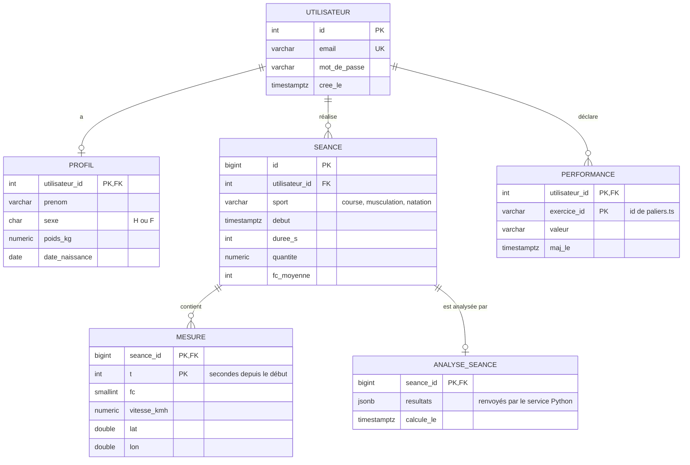

# Base de données

DataFit utilise **PostgreSQL 17** (choix expliqué dans l'[ADR 0003](adr/0003-postgresql.md)). Seul le backend s'y connecte.

## Schéma actuel

Une seule table pour l'instant, créée par [`db/init.sql`](../db/init.sql) :

| Colonne | Type | Contraintes | Rôle |
|---|---|---|---|
| `id` | `SERIAL` | clé primaire | identifiant, attribué automatiquement |
| `email` | `VARCHAR(255)` | non nul, unique | identifiant de connexion |
| `mot_de_passe` | `VARCHAR(255)` | non nul | **empreinte** du mot de passe, jamais le mot de passe en clair (voir [Sécurité](securite.md#mots-de-passe)) |
| `cree_le` | `TIMESTAMP` | non nul, défaut `now()` | date de création du compte |

## Schéma cible 🚧

Proposition, déduite de ce qu'affichent les pages du front. À valider en équipe avant de créer les tables.



Lecture : `||--o{` signifie « un … pour zéro ou plusieurs … ». Un utilisateur a zéro ou plusieurs séances ; chaque séance appartient à exactement un utilisateur.

Quelques choix expliqués :

- **`MESURE` a une clé composée `(seance_id, t)`** : une mesure n'existe qu'à l'intérieur d'une séance, et il n'y a qu'une mesure par seconde. Pas besoin d'un `id` séparé.
- **`ANALYSE_SEANCE.resultats` en `JSONB`** : un type PostgreSQL qui stocke du JSON tout en permettant d'y chercher. Les indicateurs calculés par l'équipe SD vont évoluer ; les mettre en JSON évite de modifier la table à chaque nouvel indicateur. Si un indicateur devient central (affiché partout, trié, filtré), on le sortira dans une vraie colonne.
- **`timestamptz` plutôt que `timestamp`** : garde le fuseau horaire. Avec des montres et des utilisateurs dans différents fuseaux, c'est la règle à suivre partout. La colonne `cree_le` actuelle est à convertir.
- **Volume** : une séance d'une heure à une mesure par seconde, c'est 3 600 lignes dans `MESURE`. PostgreSQL gère des dizaines de millions de lignes sans problème avec le bon index (ici, la clé primaire suffit).

## Conventions de nommage

- Tables et colonnes en `snake_case`, au singulier : `seance`, `utilisateur_id`.
- Clé primaire : `id`. Clé étrangère : `<table>_id`.
- Pas d'accents ni de mots réservés SQL (`user`, `order` sont à éviter).
- Toute colonne de date se termine par `_le` (`cree_le`) ou est un nom explicite (`debut`).

## Faire évoluer le schéma

### Le problème actuel

`db/init.sql` n'est exécuté **qu'une seule fois**, à la création du volume Docker. Si quelqu'un ajoute une table dans ce fichier, les bases déjà créées sur les autres machines ne la verront pas. La seule solution aujourd'hui est de tout effacer :

```bash
docker compose down -v   # -v supprime le volume, donc TOUTES les données locales
docker compose up --build
```

Ça passe en développement, jamais avec de vraies données.

### La solution standard : les migrations (recommandé)

Une **migration** est un petit fichier SQL numéroté qui décrit *un changement* du schéma. Un outil retient lesquelles ont déjà été appliquées et n'exécute que les nouvelles, au démarrage du back. C'est ce qu'on fait en entreprise : le schéma est versionné comme le code.

Pour Spring Boot, l'outil le plus courant est **Flyway** :

1. Ajouter la dépendance `spring-boot-starter-flyway` (ou `flyway-core` + `flyway-database-postgresql`) au `pom.xml`.
2. Créer `backend/src/main/resources/db/migration/` et y mettre :
   ```
   V1__creation_utilisateur.sql      ← le contenu actuel de init.sql
   V2__creation_profil.sql
   V3__creation_seance_et_mesure.sql
   ```
3. Retirer `db/init.sql` du `docker-compose.yml`.

Règle d'or : **une migration déjà poussée ne se modifie jamais.** Pour corriger, on en écrit une nouvelle (`V4__ajout_colonne_x.sql`). Sinon, Flyway détecte que le fichier a changé et refuse de démarrer.

C'est aussi pour ça que `spring.jpa.hibernate.ddl-auto=none` : on interdit à Hibernate de créer ou modifier les tables tout seul, ce qui serait imprévisible.

## Se connecter à la base en local

Avec Docker lancé, la base écoute sur le port **5433** de ta machine (5432 dans le réseau Docker) :

```bash
docker compose exec db psql -U datafit_user -d datafit
```

Ou avec un outil graphique (DBeaver, l'extension PostgreSQL de VS Code) : hôte `localhost`, port `5433`, base `datafit`, utilisateur et mot de passe de ton `.env`.
