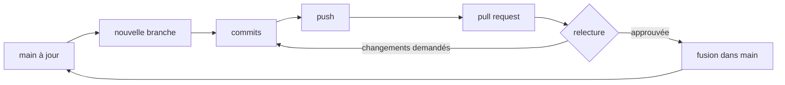

# Guide de contribution

Comment travailler à cinq sur le même dépôt sans se marcher dessus. Ces règles reprennent les pratiques les plus courantes en entreprise.

## Le principe : `main` est toujours stable

La branche `main` doit **toujours** compiler et se lancer. Personne ne pousse directement dessus : tout passe par une branche et une **pull request** (PR), relue par au moins un autre membre.

Recommandé : activer la protection de `main` sur GitHub (*Settings → Branches → Add rule*) pour rendre ces règles obligatoires plutôt que basées sur la bonne volonté.

## Le cycle de travail



En commandes :

```bash
git switch main
git pull                                  # partir de la dernière version
git switch -c feat/inscription-back       # nouvelle branche
# ... coder ...
git add backend/
git commit -m "feat(back): endpoint d'inscription"
git pull --rebase origin main             # récupérer ce que les autres ont fusionné entre-temps
git push -u origin feat/inscription-back
```

Puis ouvrir la PR sur GitHub avec le lien affiché.

**Une branche = un sujet.** Une PR qui fait « l'inscription + un correctif CSS + le README » est difficile à relire et à annuler. Mieux vaut trois petites PR.

## Nommer les branches

`type/description-courte`, en minuscules avec des tirets :

| Préfixe | Pour | Exemple |
|---|---|---|
| `feat/` | nouvelle fonctionnalité | `feat/page-progression` |
| `fix/` | correction de bug | `fix/scroll-landing` |
| `docs/` | documentation | `docs/api-seances` |
| `refactor/` | réorganiser le code sans changer ce qu'il fait | `refactor/hooks-dashboard` |
| `chore/` | outillage, dépendances, config | `chore/docker-analyse` |

## Messages de commit : Conventional Commits

Format très répandu, lisible par les humains et par les outils :

```
type(portée): description à l'infinitif ou au présent, en minuscules
```

- **type** : `feat`, `fix`, `docs`, `refactor`, `test`, `chore`, `style` (mise en forme pure).
- **portée** (facultative) : la partie concernée, `front`, `back`, `analyse`, `db`, `docker`.
- **description** : ce que fait le commit, en moins de 70 caractères.

Exemples :

```
feat(front): ajoute le filtre par sport dans l'historique
fix(back): renvoie 409 si l'e-mail est déjà utilisé
docs: décrit le contrat du service d'analyse
chore(docker): ajoute le service analyse au compose
```

À éviter : `update`, `modifs`, `fix bug`, `wip`. Dans trois mois, `git log` doit raconter l'histoire du projet.

Un commit = un changement cohérent. Si le message a besoin d'un « et », c'est souvent deux commits.

## Pull requests

### Décrire la PR

Une bonne description répond à trois questions :

```markdown
## Quoi
Ajoute l'endpoint POST /api/auth/inscription.

## Pourquoi
Première étape pour remplacer la connexion de démonstration du front.

## Comment tester
1. docker compose up --build
2. curl -X POST localhost:8080/api/auth/inscription -H "Content-Type: application/json" \
     -d '{"email":"a@b.fr","motDePasse":"test1234"}'
3. Vérifier la réponse 201, puis un second appel → 409.
```

Ajouter une capture d'écran pour tout changement visible.

### Relire une PR

La relecture (*code review*) sert d'abord à **partager la connaissance du code**, ensuite à trouver des erreurs. Points à vérifier :

- Ça fait ce que la description annonce ? Tu as lancé le code ?
- Est-ce lisible sans explication orale ?
- Pas de secret, de `console.log` oublié, de code commenté laissé en place ?
- La doc (`docs/`, `.env.example`) est-elle à jour ?

Les commentaires portent sur le code, pas sur la personne. Distinguer ce qui bloque (« ce mot de passe est stocké en clair ») de ce qui est une suggestion (« suggestion : nom plus parlant ? »).

### Fusionner

- Au moins **une approbation**.
- Fusion par **Squash and merge** recommandée pour les petites PR : tous les commits de la branche deviennent un seul commit propre sur `main`.
- Supprimer la branche après la fusion (GitHub propose un bouton).
- Prévenir l'équipe si la PR touche un fichier partagé (`App.tsx`, `docker-compose.yml`, `pom.xml`, `package.json`).

## Définition de « terminé »

Une tâche n'est terminée que si :

- [ ] le code compile (`npm run build`, `./mvnw package`) et le lint passe (`npm run lint`) ;
- [ ] le projet se lance avec `docker compose up --build` ;
- [ ] les tests existants passent, et les fonctions de calcul ajoutées ont un test ;
- [ ] la doc concernée est à jour (`docs/`, `.env.example`, tableau des endpoints) ;
- [ ] la PR est relue et fusionnée.

## Style de code

| Partie | Règles |
|---|---|
| Front | `npm run lint` sans erreur. Composants en `PascalCase.tsx`, hooks en `useQuelqueChose.ts`, fonctions pures dans `lib/`. Code et commentaires en français, comme l'existant. |
| Back | Conventions Java standard : classes en `PascalCase`, méthodes en `camelCase`, une classe publique par fichier, indentation 4 espaces. |
| Python | Conventions PEP 8. Formateur recommandé : `ruff format`. |
| SQL | Mots-clés en majuscules, noms en `snake_case`. |

## Suivi des tâches

Recommandé : utiliser les **Issues** GitHub pour chaque tâche et un tableau **GitHub Projects** (colonnes À faire / En cours / En relecture / Terminé). Une PR qui contient `Closes #12` dans sa description ferme automatiquement l'issue 12 à la fusion. On sait ainsi qui fait quoi, et la PR est reliée au besoin qu'elle traite.
