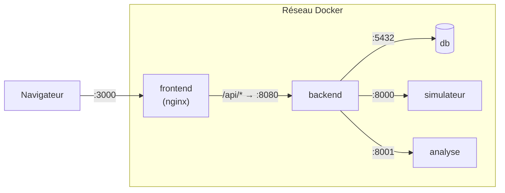

# Déploiement

**Déployer**, c'est mettre une version du projet en ligne, sur une machine accessible par d'autres que nous.

## Environnements

En entreprise, on distingue en général trois **environnements**, c'est-à-dire trois copies du système qui tournent séparément :

| Environnement | Rôle | Chez DataFit |
|---|---|---|
| **Développement** (local) | la machine de chaque développeur | `npm run dev` ou `docker compose up` |
| **Préproduction** (*staging*) | copie fidèle de la production, pour tester avant de livrer | aperçus Vercel de chaque PR (front seulement) |
| **Production** | la version utilisée pour de vrai | front sur Vercel depuis `main` ; back et services Python non hébergés 🚧 |

Chaque environnement a **ses propres secrets** et **sa propre base**. On ne teste jamais sur la base de production.

## Front : Vercel

- Vercel construit et publie le front à chaque push sur `main`, et crée une adresse d'aperçu pour chaque PR.
- Réglage indispensable : *Settings → Build and Deployment → Root Directory* = `frontend`.
- `frontend/vercel.json` renvoie toutes les adresses vers `index.html`, sinon un rafraîchissement sur `/dashboard` donnerait une erreur 404 (c'est React Router, dans le navigateur, qui choisit la page).

**Limite actuelle** : seul le front est en ligne. Il appelle maintenant le back, donc la version Vercel ne permet ni de se connecter ni d'enregistrer de séance tant que le back n'est pas hébergé. Pour une démonstration complète, lancer le projet en local avec `./lancer.sh`.

## Back et base : à choisir 🚧

Options possibles quand il faudra héberger le back, à trancher dans un ADR :

| Option | Avantages | Inconvénients |
|---|---|---|
| Hébergeur de conteneurs (Render, Railway, Fly.io) | réutilise directement nos `Dockerfile` ; base PostgreSQL gérée proposée | offres gratuites limitées (mise en veille, quotas) |
| Serveur de l'université ou VPS (machine virtuelle louée) | contrôle total, `docker compose` tel quel | à administrer soi-même : mises à jour, HTTPS, sauvegardes |
| Démonstration en local uniquement | aucun coût | pas d'adresse publique à montrer |

Quelle que soit l'option : HTTPS obligatoire, secrets dans les réglages de l'hébergeur (jamais dans le dépôt), sauvegarde de la base, et **authentification en place avant toute mise en ligne** (voir [Sécurité](securite.md#authentification)). Les cinq services doivent être hébergés : back, base, simulateur et analyse.

## Avec Docker

`./lancer.sh` (qui appelle `docker compose up --build`) lance la même chose qu'en production, sur ta machine :

nginx joue deux rôles : il sert les fichiers du site, et il transmet les requêtes `/api/...` au back (rôle de *reverse proxy*, voir [glossaire](glossaire.md#reverse-proxy)). Le navigateur ne parle donc qu'à une seule adresse.

## Intégration continue

L'**intégration continue** (CI) fait vérifier automatiquement chaque push et chaque PR par un serveur. Si quelque chose casse, la PR est marquée en rouge avant même la relecture.

Le workflow est dans [`.github/workflows/ci.yml`](../.github/workflows/ci.yml) et tourne sur GitHub Actions :

| Tâche | Ce qu'elle vérifie |
|---|---|
| `frontend` | `npm ci` puis `npm run build` (compilation TypeScript et build Vite) |
| `backend` | `./mvnw -B -DskipTests package` (compilation Java 21) |

Les tests du back sont désactivés (`-DskipTests`) parce qu'ils démarrent l'application et ont besoin d'une base. Prochaines étapes : ajouter un service PostgreSQL au workflow pour les activer, le lint du front, et les tests Python de l'analyse.
