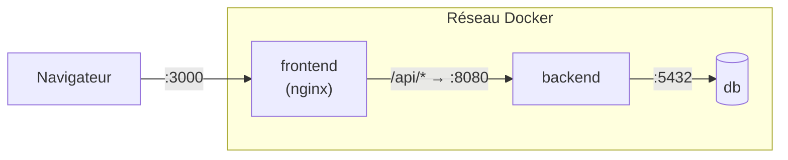

# Déploiement

**Déployer**, c'est mettre une version du projet en ligne, sur une machine accessible par d'autres que nous.

## Environnements

En entreprise, on distingue en général trois **environnements**, c'est-à-dire trois copies du système qui tournent séparément :

| Environnement | Rôle | Chez DataFit |
|---|---|---|
| **Développement** (local) | la machine de chaque développeur | `npm run dev` ou `docker compose up` |
| **Préproduction** (*staging*) | copie fidèle de la production, pour tester avant de livrer | aperçus Vercel de chaque PR (front seulement) |
| **Production** | la version utilisée pour de vrai | front sur Vercel depuis `main` ; back non hébergé 🚧 |

Chaque environnement a **ses propres secrets** et **sa propre base**. On ne teste jamais sur la base de production.

## Front : Vercel

- Vercel construit et publie le front à chaque push sur `main`, et crée une adresse d'aperçu pour chaque PR.
- Réglage indispensable : *Settings → Build and Deployment → Root Directory* = `frontend`.
- `frontend/vercel.json` renvoie toutes les adresses vers `index.html`, sinon un rafraîchissement sur `/dashboard` donnerait une erreur 404 (c'est React Router, dans le navigateur, qui choisit la page).

**Limite actuelle** : seul le front est en ligne. Tant qu'il utilise des données de démonstration, ça suffit. Dès qu'il appellera le back, la version Vercel ne fonctionnera plus sans un back hébergé.

## Back et base : à choisir 🚧

Options possibles quand il faudra héberger le back, à trancher dans un ADR :

| Option | Avantages | Inconvénients |
|---|---|---|
| Hébergeur de conteneurs (Render, Railway, Fly.io) | réutilise directement nos `Dockerfile` ; base PostgreSQL gérée proposée | offres gratuites limitées (mise en veille, quotas) |
| Serveur de l'université ou VPS (machine virtuelle louée) | contrôle total, `docker compose` tel quel | à administrer soi-même : mises à jour, HTTPS, sauvegardes |
| Démonstration en local uniquement | aucun coût | pas d'adresse publique à montrer |

Quelle que soit l'option : HTTPS obligatoire, secrets dans les réglages de l'hébergeur (jamais dans le dépôt), et sauvegarde de la base.

## Avec Docker

`docker compose up --build` lance la même chose qu'en production, sur ta machine :



nginx joue deux rôles : il sert les fichiers du site, et il transmet les requêtes `/api/...` au back (rôle de *reverse proxy*, voir [glossaire](glossaire.md#reverse-proxy)). Le navigateur ne parle donc qu'à une seule adresse.

## Intégration continue (recommandé) 🚧

L'**intégration continue** (CI) consiste à faire vérifier automatiquement chaque PR par un serveur : compilation, lint, tests. Si quelque chose casse, la PR est marquée en rouge avant même la relecture. C'est la norme en entreprise.

Avec **GitHub Actions** (gratuit pour un dépôt public), un fichier `.github/workflows/ci.yml` suffit. Point de départ :

```yaml
name: CI
on: [pull_request]

jobs:
  front:
    runs-on: ubuntu-latest
    defaults: { run: { working-directory: frontend } }
    steps:
      - uses: actions/checkout@v4
      - uses: actions/setup-node@v4
        with: { node-version: 22, cache: npm, cache-dependency-path: frontend/package-lock.json }
      - run: npm ci
      - run: npm run lint
      - run: npm run build

  back:
    runs-on: ubuntu-latest
    defaults: { run: { working-directory: backend } }
    steps:
      - uses: actions/checkout@v4
      - uses: actions/setup-java@v4
        with: { distribution: temurin, java-version: 21, cache: maven }
      - run: ./mvnw -B package -DskipTests
```

Les tests du back sont désactivés ici (`-DskipTests`) parce qu'ils démarrent l'application et ont besoin d'une base. On les activera en ajoutant un service PostgreSQL au workflow, ou avec Testcontainers.
